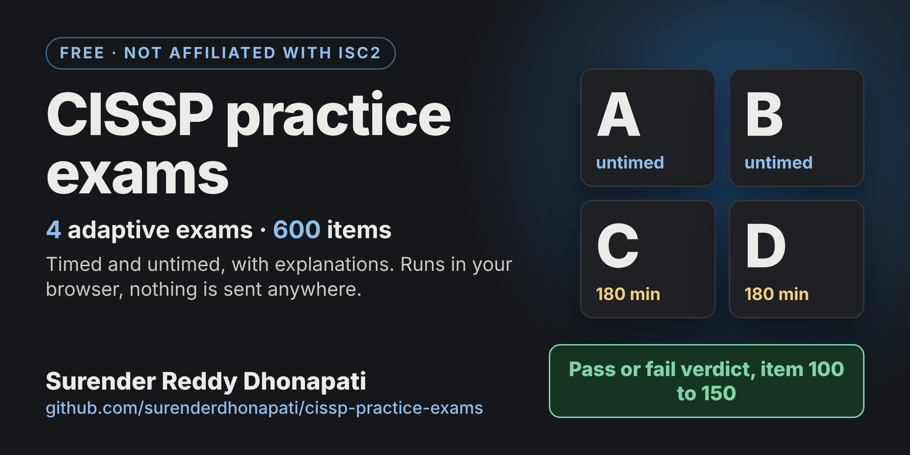
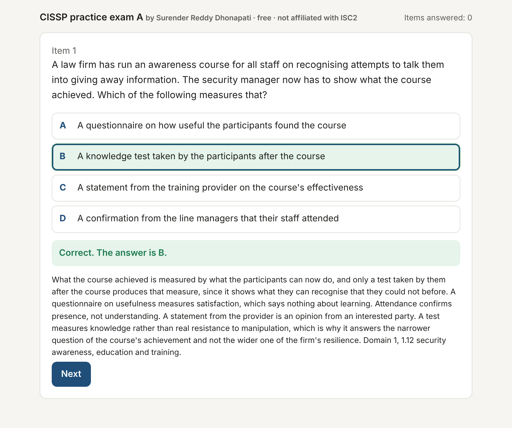
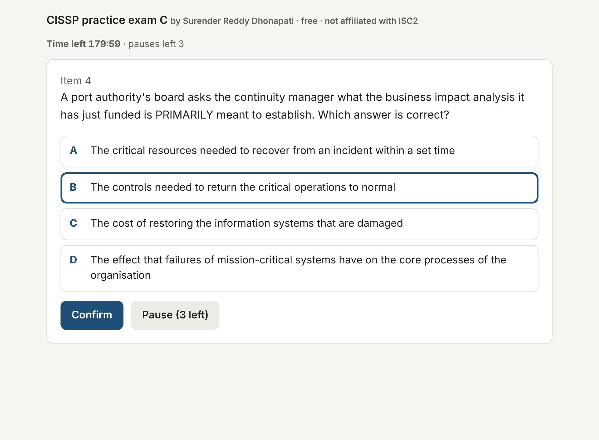
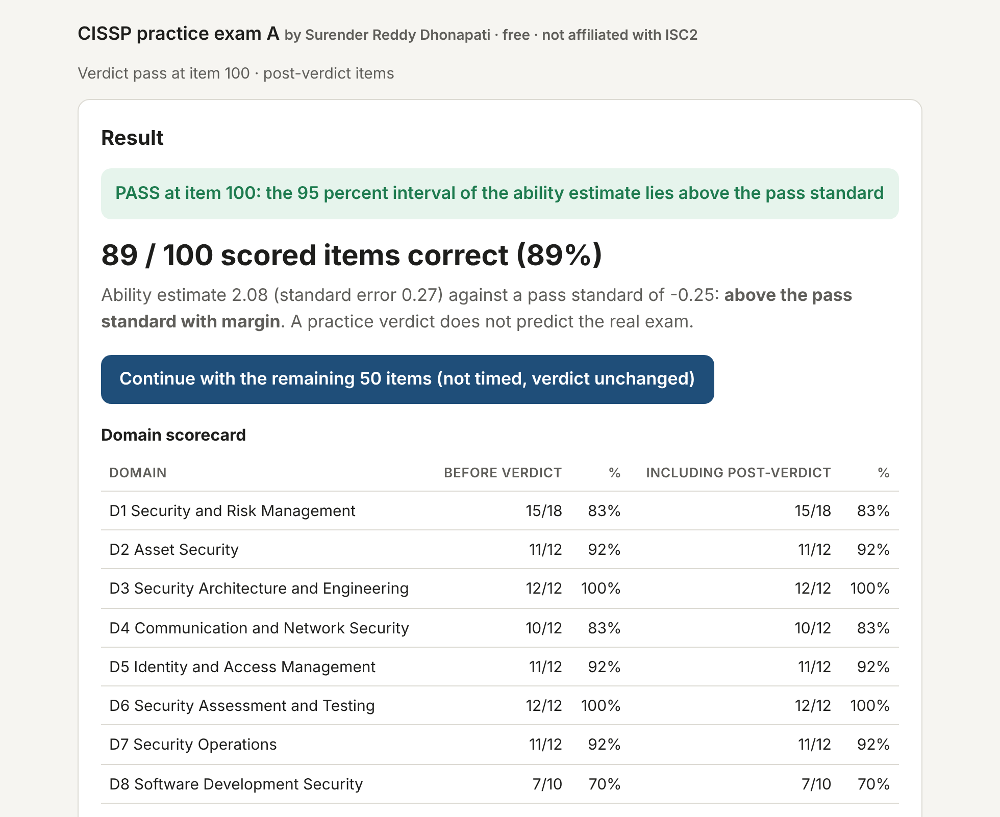
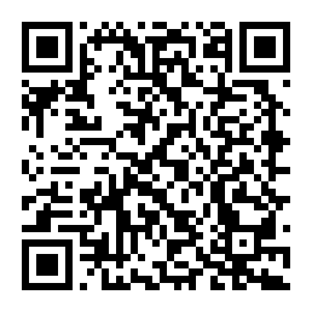

# CISSP practice exams by Surender Reddy Dhonapati, free, not affiliated with ISC2

    

> **Please read this first.**
>
> These practice exams are an independent study aid. They are not official, they are not affiliated with, endorsed by or reviewed by ISC2, and they use neither ISC2's questions nor ISC2's scoring. A pass in these practice exams does not guarantee, predict or imply a pass in the real CISSP exam. Use them to find your weak spots and to train your pace, not as a verdict on your readiness.
>
> **Reproduction and commercial use are strictly prohibited.** You may use the exams for your own study and share the link to this repository. Copying the questions, redistributing the files, building other products, courses, question banks or training sets from them, and any analysis of the content for commercial purposes are not permitted. The terms of use are at the end of this page.
>
> **Personal project.** This is a personal project, built in my own time with my own resources. It is not connected to, sponsored by or endorsed by any employer, past or present, and it does not reflect their views.

## What this is

Four adaptive practice exams for the CISSP, 150 items each, 600 items in all, written on the ISC2 CISSP exam outline across all eight domains and weighted as in the outline. Each exam is one self-contained HTML file that runs entirely in your browser. There is nothing to install, nothing to sign up for, and nothing is sent anywhere.

Each exam adapts to you the way a computerised adaptive test does. It starts in the middle of the difficulty range, serves harder items when you answer correctly and easier ones when you do not, keeps the eight domains in balance, and reaches a verdict between item 100 and item 150 once your ability estimate is clearly above or clearly below the pass standard. The real exam works on the same principle. The engine here is my own and does not reproduce ISC2's.

## The four exams

| Exam | Mode | What you get |
|---|---|---|
| A | Untimed, with explanations | After every answer you see whether it was right, the correct answer and an explanation of why the other options are wrong. Close the tab whenever you like and resume where you stopped. |
| B | Untimed, with explanations | The same mode as A with a different set of 150 items. |
| C | Timed, 180 minutes | No feedback during the exam, three pauses per attempt, the clock and the leaving rules of the real exam. The explanations are in the review at the end. |
| D | Timed, 180 minutes | The same mode as C with a different set of 150 items. |

The 600 items are all different across the four exams. Take the untimed exams first to learn, then the timed ones to train pace and nerve.

## What it looks like

| Untimed exam, feedback after every answer | Timed exam, 180 minutes on the clock |
|---|---|
|  |  |

## How to use them

Download the file of the exam you want (cissp-practice-exam-A.html to cissp-practice-exam-D.html) and open it in a current browser on a computer or a phone, or open the exams online at https://surenderdhonapati.github.io/cissp-practice-exams/ . Press Start, choose an option with the mouse or with the keys 1 to 4, and confirm with Enter.

Your progress is saved in the browser after every answer, in the storage of that browser on that device. A private or incognito window, or clearing the site data, loses the progress. The page tells you on the start screen if storage is not available.

The rules of the timed exams are the rules of the real one, as far as a browser can imitate them. You have 180 minutes on the clock and no feedback during the exam. You have three pauses per attempt, as long as you like. Closing the tab, or leaving the page hidden for more than thirty seconds, counts as a pause and costs five seconds. When all three pauses are used and you leave again, the attempt ends. If the time runs out before item 100, the attempt is a fail, as in the real exam. After item 100 the verdict is decided by your ability estimate at that moment.

## What you get at the end

The results page shows the verdict and the item at which it was reached, your ability on a simple scale (above the pass standard with margin, above the pass standard, at the boundary, below the pass standard, below with margin), a scorecard per domain, the difficulty profile of what you answered, the timing for the timed exams, the sub-domains in which you missed items, and a full review of every item with your answer, the key and the explanation, with filters for wrong items only and per domain. After the verdict you can continue with the remaining items, untimed and without changing the verdict, to see the whole set.

Three buttons let you take your performance elsewhere. **Copy analysis** puts a plain-text summary with the item log and your ability history on the clipboard. **Download JSON** saves every item you saw with the stem, the options, your choice, the key and the explanation, together with the timing and the ability history, as a file. **Print** prints the review. Paste the analysis or upload the JSON into the AI model or evaluation tool of your choice and ask it where you are weak, how your pace compares or which concepts you keep confusing. The data is yours.

## A note from the author

A great deal of work went into these exams: writing 600 items on the outline, checking every one against gates for difficulty, length, answer patterns and give-away wording, building the adaptive engine, testing it with thousands of simulated candidates and then in the browser. I am giving them away for free so that anyone preparing for the CISSP can practise under realistic conditions. All I ask in return is that you do not distribute them commercially and do not copy the questions into other products. If they helped you, a star on this repository, a line on LinkedIn or a small tip is appreciated.

## Support this work

Nothing is expected and the exams stay free either way. If they helped you and you want to say thank you, please tip me: by card, Apple Pay or PayPal at [ko-fi.com/surenderdhonapati](https://ko-fi.com/surenderdhonapati), by PayPal directly at [paypal.me/surencarpe](https://paypal.me/surencarpe), or in India by UPI to amma32167@ybl (scan the code with any UPI app).

## Privacy

Everything stays in your browser. The files make no network connection, set no cookies, contain no tracking and send nothing anywhere. Your progress and your results exist only in the browser storage of the device you used, and you delete them with Start over or by clearing the site data.

## Accessibility

The exams are standard HTML text with ordinary form controls. You can use them with the keyboard alone (1 to 4 to choose, Enter to confirm), the font size follows your browser settings, the colours meet WCAG AA contrast, and in the timed exams the remaining time is announced to screen readers once a minute. If you hit a barrier, please report it with the issue template.

## Reporting a wrong item

Every item was written and checked with care, but 600 items are 600 chances to be wrong. If you think an item is keyed wrongly, has a weak explanation or a flawed option, open an issue with the template **Item error report** and give the exam, the item number as shown in the review, what seems wrong and, if you have one, a reference. Corrections are published in a new version.

## Versions

Every file shows its version and build date on the start screen. The file names are permanent, so links do not break. CHANGELOG.md lists every change to the item banks by item id and date.

## Practice exams for other certifications

The same format now exists for the CISM: [cism-practice-exams](https://github.com/surenderdhonapati/cism-practice-exams), four linear exams of 150 items each, two untimed with explanations and two timed at 240 minutes.

I hold these certifications and can build practice exams in the same format for them: CISA, AWS Certified Security - Specialty (SCS-C03), Microsoft Azure Administrator (AZ-104), CompTIA Security+ and Splunk Core Certified User. I am currently preparing for the Claude Certified Architect Professional (CCAR-P) and the IAPP Artificial Intelligence Governance Professional (AIGP), and practice exams for those can follow later.

If you would like one of these, open an issue with the template **Practice exam request** or message me on LinkedIn and tell me which certification. The ones with the most requests come first.

## About me

My background is governance, risk and compliance and IT audit, and I go deep on information security and cybersecurity, EU cybersecurity regulation (DORA, NIS2, MaRisk, BAIT), cloud security on AWS and Azure, and AI governance (EU AI Act, NIST AI RMF, ISO 42001), including AI agents and agentic workflows. Based in Frankfurt am Main.

| Certification | Issued | Badge |
|---|---|---|
| CISSP (ISC2) | November 2026 | [View badge on Credly](https://www.credly.com/badges/ada4d8c9-fbcc-4ac6-8441-d722789a06d7/public_url) |
| CISM (ISACA) | 2026 | [View badge on Credly](https://www.credly.com/badges/e20fc79e-5552-4be9-baa8-dfb30786422b/public_url) |
| CISA (ISACA) | April 2022 | [View badge on Credly](https://www.credly.com/badges/b9bee521-6d24-4142-bd12-740c87fdc235/public_url) |
| AWS Certified Security - Specialty (SCS-C03) | May 2026 | [View badge on Credly](https://www.credly.com/badges/69363e79-92b8-4ad7-a3fd-1133c3eaca45/public_url) |
| Microsoft Azure Administrator (AZ-104) | | [View badge on Microsoft](https://learn.microsoft.com/api/credentials/share/en-us/DhonapatiSurenderReddy-0112/464F133497AB33FC?sharingId=C5B22DF95890904E) |
| CompTIA Security+ | April 2025 | [View badge on Credly](https://www.credly.com/badges/32ccba4e-11d9-42db-8704-1e5acc9c1c81/public_url) |
| Splunk Core Certified User | | [View badge on Credly](https://www.credly.com/badges/f37e6d8f-7a66-4fee-ae78-7c30f8fd4b16/public_url) |

LinkedIn: [in/surendercyber](https://www.linkedin.com/in/surendercyber)
Xing: [Surender Reddy Dhonapati](https://www.xing.com/profile/SurenderReddy_Dhonapati/cv)

## Terms of use

Copyright 2026 Surender Reddy Dhonapati. All rights reserved, with this permission: you may use the four exam files for your own, non-commercial study, and you may share the link to this repository.

Everything else requires my written permission. In particular, you may not reproduce or redistribute the files or their content in any form; copy the questions, options or explanations into other collections, apps, courses, question banks, books, videos or training sets; modify, translate or adapt them; use them or their content for any commercial purpose, including the analysis of the items for commercial products and services; or use them to train, fine-tune or evaluate AI models for commercial purposes. If you are unsure whether your use is allowed, ask me on LinkedIn before you start.

CISSP is a registered certification mark of ISC2. These practice exams are an independent study aid and are not affiliated with, endorsed by or reviewed by ISC2. The adaptive engine imitates the behaviour of a computerised adaptive test and does not reproduce ISC2's scoring. A practice verdict does not predict your result in the real exam.

This is a personal project, built in my own time with my own resources. It is not connected to, sponsored by or endorsed by any employer, past or present, and it does not reflect their views.
